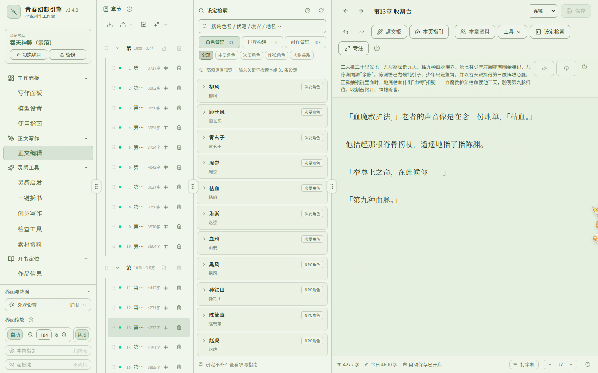
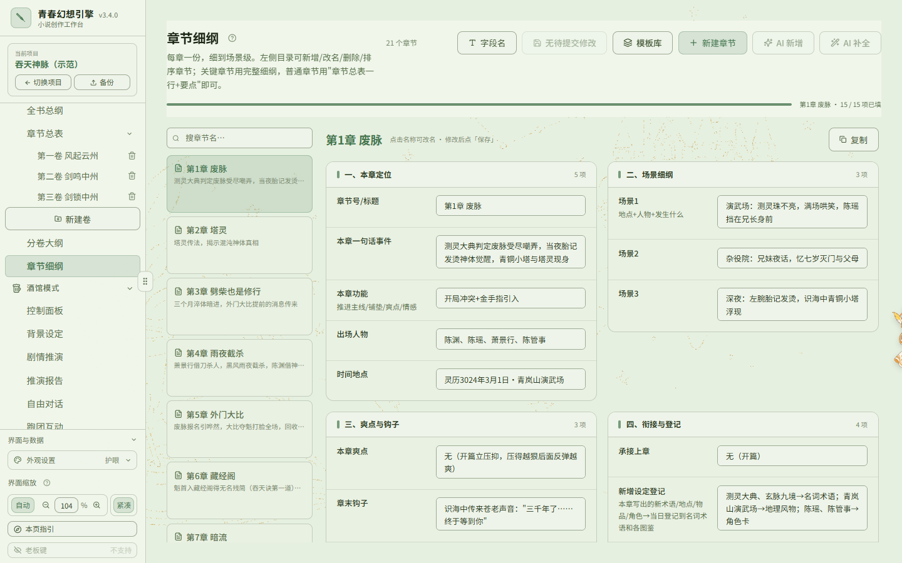
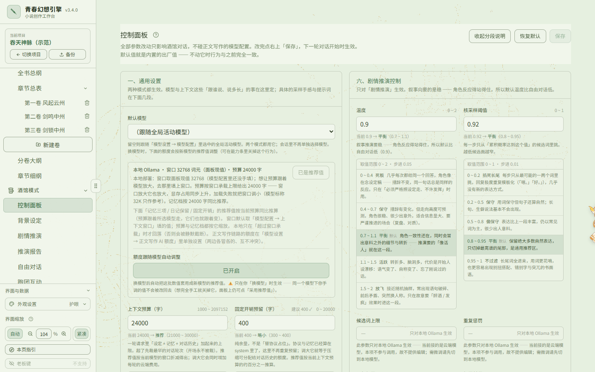
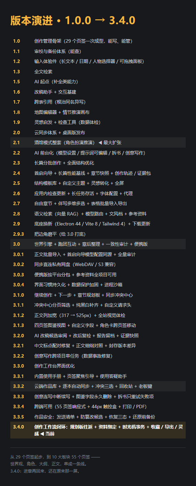

<div align="center">


# 青春幻想引擎 · Youth Fantasy Engine

**把世界观、角色、大纲、正文串成一条线的长篇创作工作台**

桌面版（Windows）｜ 便携版（U 盘即走）｜ **网页版**（浏览器直接用） ｜ 当前源码版本 `v3.5.4`

📦 仓库：[Gitee](https://gitee.com/tgxy2026/youth-fantasy-engine)　｜　[GitHub](https://github.com/tgxy2026/youth-fantasy-engine)　｜　⬇️ 下载：[Releases](https://gitee.com/tgxy2026/youth-fantasy-engine/releases)

🖥️ 三种形态：**桌面安装版**（免 Node，双击安装）　｜　**便携版**（U 盘即走，需 Node.js）　｜　**网页版**（免安装，游客本地存 / 登录账号云端存）
🌐 网页版直达：<https://youth-fantasy-engine.online>（浏览器打开就能写，不用装任何东西）
🔗 3.3.2 起：**同一个账号，桌面、网页、换台电脑，接着上一句写**（云端作品库 · 逐本自动同步 · 冲突由你选 · 删了能捞回）

</div>

---

## 写在前面（请先读这段）

**1. 这是一款使用 AI 辅助开发的项目。**

从第一行代码到现在，开发过程大量借助了 AI 编程工具。这点我先摊开讲，不藏着。

**2. 数据位置和联网范围，请按你使用的形态与功能确认。**

- 桌面与便携版的手动写作、资料查看和本地检查可以离线使用；AI 功能需要你配置的本地或云端模型服务。
- 使用云端模型时，本次功能取用的正文与资料会发往你配置的端点；网页版云端模式还会把账号资料保存到服务器。各 AI 入口可查看数据来源说明。
- 除模型请求外，自动检查更新、联网检索、云盘同步和网页版账号/存储也可能联网。使用本地模型不等于所有功能都离线；请按需关闭更新检查及其他联网功能。

**3. 关于内置的 AI 功能，我的立场是「辅助，不是代笔」。**

软件内置了一整套 AI 能力：一键续写、整章改写、一键拆书、创意写作、角色扮演推演……但设计这些功能的**本意是辅助创作** —— 帮你把设定理顺、把大纲排好、在卡壳的地方推一把，让你写得更顺，而不是替你写。

**我不建议使用 AI 大规模生成小说正文。**

如果你只是想玩玩、图个新鲜，那无所谓，功能就在那儿。但如果你真心想成为一名网络小说作者 —— **不建议**。作品得是你自己的，这条路没有捷径可走。

---

## 它解决什么问题

写长篇，真正的敌人往往不是"没有灵感"，而是**失控**。你有没有遇到过这些事：

- 世界观写了一箩筐，写到第 80 章想查「主角师父的师门叫什么」，翻了半小时没找着；
- 人物越写越多，谁跟谁什么关系全靠脑子记，写着写着就串了；
- 埋了个伏笔，二十万字以后你自己全忘了，读者倒是记得清清楚楚；
- 大纲在 A 文档、正文在 B 文档、设定在 C 文档，改一处要同步三处；
- 写到一半卡住，想推演「主角这时如果选 X 会怎样」，只能在脑子里空转。

青春幻想引擎就是为这些事做的。

它**不是「AI 帮你写小说」**，而是 —— **把你散落在各个文档里的创作资产，收进一个有结构、能互相关联、能按需喂给 AI 的工作台。**

---

## 功能总览

**10 个板块，56 个页签。**（完整项目下全部显示；自定义项目里由你在「功能模块」里勾选启用）

| 板块 | 包含页签 |
|---|---|
| **工作面板** | 写作面板 · 模型设置 · 使用指南 · 关于打赏 |
| **正文写作** | 正文编辑（含分卷 / 章节管理） · **投稿广场** |
| **灵感工具** | 灵感启发 · 一键拆书 · 创意写作 · 检查工具 · 素材资料 |
| **开书定位** | 作品信息 · 世界设定 · 力量体系 · 政治架构 · 经济基础 · 宗教信仰 · 司法制度 |
| **角色管理** | 主要角色 · 次要角色 · NPC · 人物关系 |
| **世界构建** | 国家势力 · 势力关系 · 地理风物 · 地图编辑 · 种族生物 · 物品资源 · 历史事件 · 名词术语 · 其他设定 · **世界引擎** |
| **大纲规划** | 全书总纲 · 分卷大纲 · 章节细纲 · 章节总表 |
| **酒馆模式** | 控制面板 · 背景设定 · 剧情推演 · 推演报告 · 自由对话 · **跑团互动** · 故事剧本 · 角色卡片 |
| **创作管理** | 伏笔追踪 · 时间脉络 · 情节推演 · 爽点节奏 · 写作进度 · 支线剧情 · 知情权限 · **创作轨迹** |
| **运营维护** | 写作规范 · 设定变更 · 灵感素材 · 读者反馈 |

> **3.0 起新增的页签**加粗标出：**世界引擎**（把整个世界封存成「世界包」，供其它作品引用）、**跑团互动**（AI 当 KP 带团推演）、**创作轨迹**（如实记录创作过程，供自己自证）。
> **3.5.0 新增一个页签**：**投稿广场**（与「正文编辑」同级，见下方 3.5.0 本轮重点）。
> **2026-11-12 位置调整**：「关于打赏」由「运营维护」移到「工作面板」，作为该组第 4 个页签；仍是必选、不可取消，页签总数与板块数不变。
> 另注：《地图》不是独立页签 —— 地图的增删改都在**地图编辑**页左侧列表里完成。
> **3.4.0 没有新增页签**，增强都落在已有页内：写作面板的「随手记灵感 / 章节收藏集 / 规划板资料绑定」、正文页的「本章资料」、时光机的「命名快照」、导出里的「具名方案」。

### 几个值得一提的设计

- **角色与关系双轨** —— 角色卡管「这个人是谁」，人物关系表管「谁跟谁什么关系」，可图谱可视化。
- **从总纲到细纲再到正文的完整链路** —— 分卷大纲 → 章节细纲（带事件链）→ 正文，每一层都能喂给 AI。
- **伏笔追踪** —— 埋了什么、在哪一章回收，一张表管到底，埋了不回收会被揪出来。
- **时间脉络** —— 故事内时间线，支持自定义历法，避免"人物年龄对不上"。
- **情节推演** —— 推演分歧点的不同走向，产出推演报告。
- **防剧透机制** —— 可标记「某角色在某章之前不知道某件事」，AI 推演时不会漏嘴。
- **保密等级与 AI 权限** —— `D · 终结（弃用）` 条目不作为设定资料提供给 AI；`S · 绝密` 不等于禁止发送，作者视角仍可使用，角色视角按入口与知情规则取材。请同时检查字段的 AI 参考权限。
- **一键拆书** —— 丢一本参考书进去，自动抽取人物、关系、设定，做成你自己的素材库。
- **酒馆模式** —— 让 AI 扮演你书里的角色跟你对话、推演剧情，用来找感觉、验人设。
- **伴写建议** —— 正文编辑时给出「下一句可以怎么写」的建议，你采纳或忽略，它不会替你写。
- **提示词全开放** —— 所有 AI 提示词都可在设置页里查看和修改。

---

## 快速开始

提供 **三种形态**，按需选一个即可：

### 方式一：桌面安装版（推荐，免装 Node）

到本仓库的 **Releases** 页面选择已发布版本，下载对应的 `青春幻想引擎-Setup-版本号.exe`，双击安装即可。源码版本可能先于正式发布，下载文件名与可用版本以 Releases 页面为准。

- **无需安装 Node.js**，装完直接能用；
- 数据存在本机用户目录（`%APPDATA%\youth-fantasy-engine`），**不写进安装目录**；
- 支持**应用内检查更新**：发现新版会提示，你点一下才下载。

> ⚠️ Windows 首次运行可能弹 SmartScreen 提示 —— 点「更多信息」→「仍要运行」。这是所有未购买代码签名证书的软件的常规待遇，不等于病毒警告。

### 方式二：便携版（U 盘即走，需 Node.js）

到 **Releases** 页面按系统下载对应的便携包，解压到 U 盘 / 移动硬盘 / 任意本地文件夹：

| 包名 | 启动脚本 | 适用系统 |
|---|---|---|
| `青春幻想引擎-便携版-版本号-Windows.zip` | `启动.bat` | Windows |
| `青春幻想引擎-便携版-版本号-macOS-Linux.zip` | `启动.sh` | macOS / Linux |

体积以对应版本的发布附件为准（两个包的应用本体一样，只是启动脚本不同）。

1. 双击 `启动.bat`（Windows）→ 自动拉起本地服务 → 自动打开浏览器进入写作界面；
2. **无需安装软件主体、不写注册表**，项目资料随 `data/` 目录移动；系统浏览器仍会保留自身缓存和访问记录；
3. 主数据文件在 `data/youth-fantasy-engine-data.json`，外置历史备份等载荷在同级 `blobs/` 中。优先使用应用内导出留档；手工备份便携数据时请复制整个 `data/` 目录，单独复制主 JSON 会遗漏外置载荷。

> ⚠️ 本机需装 **Node.js**（免费，约 30MB）。
> 本地服务**只绑 `127.0.0.1`**，局域网里别人访问不到。
> **自动更新检查 / 云盘同步 / 系统托盘 / 安装卸载 / PDF 直接导出**这几项依赖系统级安装或后台常驻，便携版没有；其余功能全保留。

### 方式三：网页版（免安装，浏览器直接用）

打开即可写作，**不用装 Node、不用下安装包**：<https://youth-fantasy-engine.online>

| 模式 | 谁用 | 数据在哪 | 跨设备 |
|---|---|---|---|
| **游客** | 所有访客，免费 | 存在**你自己的浏览器**里，不上传服务器 | ❌ 换设备或清了浏览数据就找不回 |
| **云端** | **打赏用户**（凭邀请码注册） | 存在服务器上，按账号隔离 | ✅ **唯一支持跨设备的形态** |

- 游客模式**功能不打折，只做提示**：首启向导、项目页入口、登录页都会明说「清浏览数据或换设备后无法找回」，并引导你**自己导出一份备份**。
- 云端模式由**站主亲手发放邀请码**，一张码只能注册一个账号；这张码同时是**找回密码的凭证**（用户名＋邀请码一起校验，拿到别人的码也改不了你的号）。
- 从 **3.3.2** 起，登录同一账号可在**项目中心 →「云端同步」→「云端作品」**里把书取回到新设备（点「下载为新书」，接着同一本云端作品写；不覆盖本机已有作品）；游客的浏览器本地库不会自动跨设备。桌面 / 便携版也可另行使用导入导出或外部云盘文件同步，切换设备前应关闭软件并等待同步完成。

### 再说一句：从源码运行

```bash
git clone https://gitee.com/tgxy2026/youth-fantasy-engine.git
cd youth-fantasy-engine
npm install
npm run dev            # 浏览器调试：http://localhost:5199
```

打包桌面版：

```bash
npm run build:desktop  # 产物输出到 release/ 目录
```

> 需要 **Node.js 20 或更高版本**。

### 系统要求

| 项 | 要求 |
|---|---|
| 操作系统 | Windows 10 / 11（64 位） |
| 内存 | 建议 8GB 以上 |
| 磁盘 | 约 500MB |
| Node.js | **桌面安装版不需要**；便携版与源码方式需要，20+ |

---

## 升级与数据迁移

### 3.x → 3.4.2（直接覆盖安装即可）

- **桌面安装版**：直接覆盖安装。程序数据在独立目录（`%APPDATA%\youth-fantasy-engine`），不会被安装包覆盖；
- **便携版**：解压新包后，把旧包的 `data/` 目录整体拷进新包同级位置；
- **网页版**：刷新页面即最新，无需操作。

3.4.0 没有破坏性结构变更：新增的章节收藏集、导出方案、命名快照都带旧数据默认值；即使回退到旧版本，这些新数据也只会被忽略，不会导致打不开。3.4.1 是 3.4.0 的精修版，只改了 AI 提示词文本、审计工具与致谢名单，**同样没有任何数据结构变更**，从 3.4.0 升级或回退都安全。3.4.2 新增的 `protocol` 是**可选字段**，旧模型配置读进来按原 `type` 自动补默认值；三家新协议与降级逻辑只在显式选择时生效，**未配置新协议时全链路与 3.4.1 逐字一致**。即使回退到 3.4.1，新字段也只会被忽略，不会导致打不开。

### 历史：2.x → 3.0（改名与数据目录迁移）

3.0 把软件正式更名为「**青春幻想引擎**」（旧名 **novel-studio**），**程序数据目录随之改变**：

| | 旧版 | 3.0 |
|---|---|---|
| 数据目录 | `%APPDATA%\novel-studio` | `%APPDATA%\youth-fantasy-engine` |

首次启动 3.0 若检测到旧版数据，会弹出「**发现旧版数据**」向导，点一下就能把旧版的书稿、向量索引、知识库与界面偏好一次性导过来。

- ✅ **数据向后兼容**，不迁移也能用；迁移只是把旧版内容搬过来；
- 🔴 **先完成导入、确认书稿都在，再去卸载旧版**；
- 🔴 **正常只需导一次**（导入＝旧库覆盖新库，重复导会盖回旧数据）；
- 完整指引见 [`docs/归档/3.0/3.0-数据迁移指导.md`](docs/归档/3.0/3.0-数据迁移指导.md)。

---

## 界面截图


<table>
<tr>
<td width="50%"><br/><sub>写作面板：继续创作、产量统计、随手记灵感、项目起步清单与章节规划板</sub></td>
<td width="50%"><br/><sub>正文编辑：章节树 + 设定检索 + 正文三栏</sub></td>
</tr>
<tr>
<td><br/><sub>角色档案：资料目录与表单</sub></td>
<td><br/><sub>人物关系：按人物的关系总表，可一键切换关系图</sub></td>
</tr>
<tr>
<td><br/><sub>章节细纲</sub></td>
<td><br/><sub>酒馆模式控制面板：出场预设、剧情推进与数值调节</sub></td>
</tr>
</table>

> 截图取自 **3.4.0 正式版**、软件内置的示范项目《吞天神脉》，实机截取、未做美化；界面细节请以当前版本为准。

---

## 数据与隐私

- **桌面版与便携版**：主数据与外置载荷保存在本机或便携目录；桌面的参考资料/向量索引另有独立存储，按对应功能的导出说明处理。
- **网页游客**：数据在当前浏览器的 IndexedDB；清除浏览器数据或换设备不会自动找回。**登录账号 / 云端作品**：数据在服务器上，按账号隔离，单账号默认 **200 MB** 配额（含图片与全部历史版本对象）；云端删除先入**回收站保留 30 天**，过期条目与无人引用的上传碎片由服务端定期自动清理。
- **模型与联网服务**：云端模型会收到本次发送的资料；检索、更新、账号存储、WebDAV/S3 及外部云盘各使用对应服务。使用第三方云盘同步也会把文件交给该云盘服务处理。
- **备份**：优先使用应用内导出；手工复制文件型资料时，应同时保留主 JSON 与同级 `blobs/`。导出有载荷读取失败提示时，应保留原资料，不把部分导出当作完整副本。
- 图片入库前会先压缩，避免库文件无限膨胀。
- ⚠️ 换设备前请先**关闭软件**并等待云盘同步完成，避免半同步状态造成数据冲突。

---

## AI 功能说明

### 支持的模型来源

**本地模型（数据不出本机）**

| 类型 | 说明 |
|---|---|
| Ollama | 填本地地址即可，推荐 |
| 本地 OpenAI 兼容服务 | LM Studio / vLLM 等任意兼容实现 |

**云端模型（会把选定上下文上传给该服务商）**

硅基流动 · DeepSeek · 通义千问 · 智谱 GLM · 豆包 · Kimi · MiniMax · 腾讯混元 · 百川智能 · 零一万物 · Groq · OpenRouter · OpenAI · 自定义接口

### 数据会发给谁

**只发给你当前选定的那个模型。**

用本地模型 → 完全不出本机；用云端模型 → 当前会话所需的上下文会上传给该服务商。软件内置上下文预算控制，让你能看清"这次要发多少、发了哪些"。

### 上下文是怎么控制的

- **预算上限**：按**模型上下文窗口的一半**算（下限 8K，上限跟随所选窗口，最高支持 2M tokens），超出的内容按优先级裁剪；
- **保密等级**：`D · 终结（弃用）` 条目从设定取材中排除；`S · 绝密` 在作者视角仍可能发送。等级过滤不会自动抹去你在正文或手动输入中粘贴的相同内容，敏感资料还应核对字段的 AI 参考权限与本次数据来源；
- **防剧透**：角色视角推演时，只看该角色在当时的章节节点应该知道的信息。

---

## 技术栈

| 层 | 选型 |
|---|---|
| 框架 | React 18.3 + TypeScript 5.5 |
| 构建 | Vite 8.3 |
| 桌面端 | Electron 44.6 + electron-builder 26 |
| 样式 | Tailwind CSS 4.3 |
| 存储 | JSON 文件（桌面·便携）／IndexedDB（浏览器·网页版游客）／服务器目录（网页版云端） |
| 图标 | lucide-react |
| 模型调用 | OpenAI 兼容协议 + Ollama 原生协议，支持 SSE 流式输出 |

---

## 项目结构

```
youth-fantasy-engine/
├── src/
│   ├── components/          React 组件（按功能域分子目录）
│   ├── lib/                 核心逻辑（门面 + 领域子目录）
│   │   ├── ai/ aiCore/ aiTasks/  AI 链路与任务实现
│   │   ├── db/              存储层（门面 + 分域实现）
│   │   ├── creative/        创意写作与断点续写
│   │   ├── revision/        候选审阅 / 快照 / 检查点
│   │   ├── sync/            云端同步
│   │   ├── help/            内置手册与分步引导
│   │   ├── text/            纯文本工具（强调、字数区间）
│   │   └── schema.ts        页签与字段定义（单一数据源）
│   ├── data/                内置数据：示范项目、素材库、提示词
│   └── assets/              资源文件
├── electron/                Electron 主进程与 preload
├── server/                  网页版服务端（账号 / 云端作品 / 部署脚本）
├── portable/                便携版启动脚本（.bat / .sh）
├── tests/                   基线测试与结构闸（npm test）
├── scripts/                 构建、验证与发布脚本
└── docs/                    文档与截图（发布说明在 docs/归档/<版本>/）
```

---

## 开发命令

| 命令 | 作用 |
|---|---|
| `npm run dev` | 启动开发服务器（:5199） |
| `npm run build` | 类型检查 + 构建前端 |
| `npm run build:desktop` | 打包 Windows 桌面版 |
| `npm test` | 跑基线测试与结构闸 |
| `npm run test:server` | 跑服务端协议自检（真起临时服务，约 20 秒） |
| `npm run typecheck` | 仅类型检查 |
| `npm run lint` | ESLint 静态检查 |
| `npm run verify` | 类型检查 + lint + 测试 |
| `npm run release-check` | 发版前检查（版本号 / 更新说明 / 页签数等一致性，不联网） |
| `npm run build:portable-pkg` | 打便携版双包（Windows / macOS-Linux 两个 zip） |
| `npm run start:portable` | 本机起便携服务（等价于双击启动脚本） |
| `npm run verify:reliability` | 跑可靠性流水线（本地档） |
| `npm run cleanup` | 清理构建 / 测试残留的进程与临时目录 |

---

## 版本演进



| 版本 | 主题 |
|---|---|
| 1.0 | 创作管理骨架（29 个页签一次成型，能写、能管） |
| 1.1 | 审校与备份体系（能查） |
| 1.2 | 输入体验件（长文本、日期、人物选择器、可拖拽面板） |
| 1.3 | 全文检索 |
| 1.5 | AI 起点（补全类能力） |
| 1.6 | 改稿助手 + 交互基建 |
| 1.7 | 跨表引用（根治同名异写） |
| 1.8 | 地图编辑器 + 情节推演画布 |
| 1.9 | 灵感启发 + 检查工具（数据体检） |
| 2.0 | 云同步体系 + 桌面版发布 |
| 2.1 | **酒馆模式整套**（角色扮演推演，最大一次扩张） |
| 2.2 | AI 前台化（模型设置 / 提示词可编辑 / 拆书 / 创意写作） |
| **2.3** | **长篇分批创作 + 全面结构优化** |
| 2.4 | 首启向导 + 长篇性能基线 + 章节快照升级 + 创作轨迹/证据包 + **世界观多套结构 / docx 拆书** |
| **2.5** | **结构模板库 + 配比对照 + 自定义主题 + 灵感转化 + 全屏 + 写作联动** |
| **2.6** | **应用内检查更新 + 跨页签长任务存活 + 字体配置 + 网络代理 + 编号补缺 + 下拉修复** |
| 2.6.2 | 撤销按钮 + DOCX 排版与投稿稿 + 伴写增强 |
| 2.6.1 | 看板娘设置 + 拆书 AI 切分 + 章节树折叠保持 + 定位上次章节 |
| **2.7** | **自由章节 + 伴写文风多维多选 + 去 AI 味儿重做 + 表格类页签批量导入导出** |
| 2.7.1–2.7.3 | 关系图 / 时间线可视化升级 + 同对多关系 + 酒馆分组上移 + 字段显示名 + 大纲规划组接入 AI + Ctrl+S 全页签生效 + 六维审计静默失败收口 |
| **2.8** | **语义检索（向量 RAG）+ 多 Agent 模型路由 + 文风档 + 全书优化工单 + 参考资料库 + 市场雷达** |
| **2.8.1–2.8.2** | **酒馆对齐 SillyTavern**（世界书精细触发 · 多候选 · 四色灯与注入额度 · 剧情分支树 · 多套档案 · 自由模式检查点与语义召回）+ 主从双栏独立滚动 + 同场角色放宽 |
| **2.8.3** | 酒馆自由对话**故事 / 世界书词条 / 剧本一键导入导出**（按模板粘贴即入库，导出可原样导回） |
| **2.9** | **底座换新**（Electron 44 · Vite 8 · Tailwind 4）+ **应用内下载更新** + 请求超时可调 + 上下文窗口按模型两态化 + 2 条高危依赖漏洞修复 |
| **2.9.1** | **让已经填好的数据真正被用起来**：连续性校验 10→14 类、检查结果落库出趋势、AI 诊断看写作节奏、结构配比预警上主面板、导出即预检、堵住隐藏列反向泄漏 |
| **2.9.2** | **让 AI 更听你的话**：颉文姬可自定义改稿要求 + 期望字数、新增「续写」（资料可勾 · 预算如实提示 · 落建议段不动原文）、模型列表筛选、生成参数微调、两处检查结果落库出趋势 —— 另修 14 项审计问题 |
| **2.9.3** | **把边角磨平（给 3.0 打底）**：故事剧本可**追加**进已有故事 + 自由对话开场白独立成「场景引入」 + 窄窗口下页头不再塌陷 + 酒馆「概率」可填小数 + 六维审计修 15 项 |
| **3.0** | **大版本**：**世界引擎**（跨作品复用世界）+ **跑团互动**（AI 当 KP）+ **章后整理** + **一致性审计** + **AI 提示词透明** + **数值言行一致** + **AI 运行账本** + **作品版本冻结**；首次提供 **便携版（U 盘版）**；⚠️ **作品题材默认不再发给 AI** |
| **3.0.1** | **接着 3.0 打磨**：新增**正文批量导入**（把整本书拖进来，预览树可改名 / 勾选 / 删卷删章）+ 创作轨迹**按卷折叠** + **首启向导模型配置与「模型设置」同源**（云端铺全量 14 家、本地 6 家，「获取模型列表」对所有平台可见）+ 修掉三个界面问题 + **全量六维审计**（P0 / P1 均为 0，另修 8 处隐患） |
| **3.0.2** | **同步直连私有网盘**：新增 **WebDAV**（坚果云 / Nextcloud / 群晖 / 极空间 / 威联通 / 飞牛）与 **S3 兼容**（MinIO / Cloudflare R2 / 阿里云 OSS / 腾讯云 COS …）两条**直连**通道 + **信任自签证书**开关（只对单个通道生效）+ 修掉**两处界面缩放定位问题**（AI 伴写说明窗跑出屏幕、5 个下拉宽屏整体右移）+ **密钥外流加固**（导出数据文件不再带出 AI 密钥） |
| **3.0.3** | **便携版换一种分发方式**（按平台两个小压缩包，**需自装 Node.js 20+**，不再下 83MB 运行时）+ **参考资料全项目可用**（原先只在一部分 AI 入口生效，现全项目 AI 都能读到）+ **同步配置改弹窗**（窗口模式下表单被裁、填不完的问题根治）+ 修**本章体检章节顺序乱** / **拆书示例框只有 3 行** / **文风档按钮被压扁** + **全量六维审计修 10 项**（含审计工具自身一处「看不见依赖图」的盲区） |
| **3.0.4** | **界面习惯不再丢**：一批「切个页签 / 重启一下就回到默认值」的开关改为**持久化**（正文编辑的设定检索栏与引用侧栏、拆书两项、两条时间轴的筛选与比例、剧情推演的简报 / 分支树、数值条带、角色表隐藏已退场、看板娘精灵收边）+ **数据保护加固**（外置载荷迁移写失败时保留源数据）+ 修**下拉被旧数据覆盖** / **弹窗焦点** + **同步并发分叉检测**（同版本不同标识也判冲突）+ **Electron 主窗口启用进程沙箱** |
| **3.1.0** | **让长篇创作工作流更容易进入 + 同步分叉可查看可恢复**：工作面板新增**继续创作 / 下一步 / 项目起步清单**（最近编辑章、未完成章、未用灵感、未回收伏笔，可忽略可延后）+ **章节规划板**（按卷 / 状态 / 关键词浏览章节，点卡直接进正文）+ **同步冲突中心**（冲突清单、双方内容、导出、章节原位恢复；恢复前自动建备份与快照）+ 第九个预制主题「**纯黑白**」+ **资料提及反向导航**（从角色 / 设定反查章节并跳转）+ **三个角色页签支持批量导入 / 导出**（导出模板 → 填写 → 导入回项目，含 AI 智能拆分）；经**两轮独立复核 + 两轮全量六维审计**，修掉 R1–R10 与审计 9 项（含「离线恢复用旧缓存覆盖本机并删掉离线新增章」「导入新角色丢失当前卡未保存编辑」等丢稿级问题） |
| **3.1.1** | **把「能用」磨成「顺手」**：冲突中心支持**分页 / 类型筛选 / 每条副本体积与合计占用**（不再一口气全渲染）+ **章节规划板**补**更新时间**与「**状态与正文不一致**」提示（只提示、不替你改）+ 第九个主题「**纯黑白**」**范围补齐**（图谱 / 地图 / 情节画布 / 结构节奏带 / 时间轴 / 燃尽图的语义色全部收成二值，类别改由**线型 / 形状 / 文字**承载）+ **模型配置支持自定义请求头**（覆盖中转站、企业网关、需额外鉴权头的服务，并内置 **OpenCode Go** 预设）；经**三轮全量审计 + 一轮独立复核**，修掉 1 P1 + 18 P2（含「按叙事序拉平章节」四处实现漂移收敛为**唯一真源**、**「已开启同步却一直没同步」的界面谎报**、检索设置读取失败会覆盖真配置） |
| **3.1.2** | **把码字区还给你**：1440 宽窗口下正文列从 317px 提到 **525px**（保底 560px，窄窗口检索栏自动让位）+ 全站视觉体检（59 个页签 + 弹窗逐页目检，修 10 处观感与体量问题）+ 全量审计修掉 2 个真缺陷（含「切换大纲卡时旧编辑会静默蒸发」） |
| **3.1.3** | **设定表按你的方式长**：**种族生物 / 物品资源 / 国家势力 / 地理风物**四个页签新增**图鉴视图**（卡片墙 + 详情，可就地编辑、可传主图）+ **自定义字段**（六种类型、改名不动数据、归档代替删除、可限适用类别、AI 可读可写开关）+ **图鉴资料包**导入导出（字段定义 + 条目 + 主图）+ **角色卡跨页签移动**（按含义对字段、丢弃前逐项确认）+ **对话引导存档**（7 天过期、不默认恢复）；经独立验收查出 **6 P1 + 6 P2 共 12 项，已全部修复**（备份图片归属错乱、类别字段整类消失、存档串项目、语义索引绕过字段权限、资料包浅校验、未知格式被覆盖、CSV 往返改内容、图片假成功、分批导入丢行、AI 回填无基准等） |
| **3.2.0** | **AI 改稿看得见、管得住、能核对**：新增**候选审阅**（AI 产出的稿子先放这儿，你决定应用还是放弃；**应用前比对正文** —— 你在期间改过就拒绝，不覆盖你的编辑）+ **改后复检**（改写完用五个本地引擎零额度复检，显示「原问题已清 / N 条没解决 / 复检没跑成」，不再拿"已改写"冒充"已解决"）+ **检查报告留档与回看**（只有「冲突 / 注意」级才存，全绿不占空间；每条带来源、章名快照、引文与「引文 N/M 可定位」）+ **证据快照**（落库那一刻就记下引文与段号，回答"当时有没有证据"，而不是"现在还能不能定位"）+ **诊断如实**（显示「已检 X/Y 章 · 发现 N 个 · 留档 N 份」，**没检成的章点名列出**，不再报成"诊断完成、没有问题"）+ **实体保留自检**（改写后哪些已登记人物 / 势力名没再出现，**只提示不判定** —— 少提一个名字常是正常润色）+ **结构化输出开关**（确认端点支持再开，默认关）+ **请求预算**（整章改写 6 次 / 一次性 3 次封顶，撞顶会停并如实说）+ **停滞不吞内容**（流式停滞时带出已收片段并如实报「已收到 N 字未采用」，**半截正文不整章落库**）；经**全量四批单测 + 四份真机契约 + 实机九步验收**，容量门槛达标（500 章 / 101 万字打开正文编辑页 264ms） |
| **3.2.1** | **修好你反馈的标点问题 + 把 3.2.0 欠的账补上**：🔴 中文标点自动配对**在搜狗 / 微软拼音下真的会补右半边了**（根因是「输入法选字期间一律不插手」挡在配对判断前面，而中文输入法上屏标点时该标志仍为真 ⇒ 功能永远走不到）+ 新增**正文与细纲对照**（五态结论；每条必须附一句能逐字落在正文的原句，摘不出就强制判「证据不足」；未体现 / 与计划不同的可一键落成报告、加入工单）+ **封存版本差异对比**（按条目列出新增 / 删除 / 修改与字段前后值，可复制 Markdown，纯只读）+ **复检结论刷新后还在**（每章最近一条，**区分「有结论」与「跑过没跑成」**）+ **换模板时有横幅点名告知**（哪个页签在换、哪些写入被拦、改动没丢）+ 修**候选配额只增不减的死锁**（已放弃 / 已应用超 30 天的旧产物自动回收，待审 / 在途一律不动）+ 图鉴导入预览显示字段类型、上传规格不再写死数字 + 新增发版检查命令 `npm run release-check` + README 页签数修正 50 → **55** |
| **3.2.2** | **修一个会写错项目的数据事故**：🔴 **创意写作跨项目串任务** —— 项目 A 正在创意写作时切到项目 B，A 的任务**不停**、面板在 B 里继续显示「运行中」，而它的新章 / 大纲 / 设定草稿 / 运行账本 / 改写候选会**带着 B 的项目 id 落库**（读的也是 B 的卷章）。现在开跑即绑定项目，换项目 / 退出项目前先判定：**不属于新项目就立即停止**，并如实提示「产出没有写入任何项目」；同项目重开不受影响（被中止的任务仍可「继续」）。⚠️ 这是 A 档（宁可停、不写错），落库层显式 pid 校验留待后续（截至 3.2.2） |
| **3.3.0** | **创作工作台界面优化**：项目卡片、侧栏、正文工具与地图布局调整；AI 校对、摘要与审阅明确展示失败或部分完成；长等待任务增加中止；保存失败时保留工作现场。详见 [3.3.0 发布说明](docs/归档/3.3/3.3.0-更新说明-发布版.md)。 |
| **3.3.1** | **不会用的时候，软件自己告诉你**：内置**使用手册**（41 篇，覆盖 55 个页签入口，离线全文检索、点结果落到那一段）+ **页签聚焦引导**（第一次进某页自动高亮关键入口，可跳过可重看）+ **使用答疑助手**（查手册不需要模型；配了模型可按手册作答，**每条回答附原文依据**、点开回到那段原文，没依据就退回检索不编）+ **连续追问**（「那还需要模型吗」这类省略句会**重新检索上一问的主题**，界面显示「接着上一问」，说不清时先问你要哪个功能）+ **界面缩放 160% 不裁字** + **校对定位能看到选中那句** + **全文检索「第 n/N 处」精确跳转** + **设定表方向键**（同列上下行，数字/下拉/长文本自动让行）+ 修复**左右分栏切卡片右栏跳回顶部**、**进章停在开头**（现在落到该章末尾、光标在文末，章节列表首次打开停在最新章）。详见 [3.3.1 发布说明](docs/归档/3.3/3.3.1-更新说明-发布版.md)。 |
| **3.3.2** | **同一个账号，桌面、网页、换台电脑，接着上一句写**：新增**云端作品库**（项目中心右上角直接取回，新设备不用先建空书）+ **逐本自动同步**（点「上传这本到云端」才上云，之后每次保存约 20 秒同步一次，**没有服务端回执不会显示已同步**）+ **冲突由你选**（保留本机上传 / 云端覆盖本机·覆盖前自动备份 / 两份都留各存一本）+ **回收站 30 天**（云端删错能恢复，也能彻底删除；过期与无引用碎片由服务端定期清理）+ **桌面版账号密码直登**（不跳浏览器、地址内置、令牌存系统安全存储）+ **登录设备管理**（逐台撤销，最多 20 台）+ **老板键**（默认 `Ctrl+Shift+F9`，可自定义，按下先存草稿；托盘图标兜底，不会再「藏起来找不回」）+ **项目中心顶部按钮合并成「外观 / 帮助」两处下拉**（1280 宽不再挤成两排）+ 登录与同步状态**进来即真实**（读到前显示「…」，不再先给一个假的「未登录」）+ 无改动时同步间隔**从 20 秒逐步退到 5 分钟**（一打字立刻回到 20 秒）。⚠️ 是**异步多端接续**、不是实时协作。详见 [3.3.2 发布说明](docs/归档/3.3/3.3.2-更新说明-发布版.md)。 |
| **3.3.3** | **把几处让人心里没底的地方修实**：**创意写作中断后续写**（自动识别已写章节与断点，正文被改或缺章安全拦截，只补未写章节）+ **图鉴字段永久删除**（删前自动备份、已填值一并清理、中断可重试）+ **拆书 50 单元只重试失败项**（已成功的 49 个结果原样保留，不再白跑白花 token）+ **图鉴图片跨四页统一限额与格式安全防范**（种族/物品/势力/地理四页合计算额，超限拦截，拒绝可执行 SVG）+ **全量审计 0 候选与 6 运行契约全过**。详见 [3.3.3 发布说明](docs/归档/3.3/3.3.3-更新说明-发布版.md)。 |
| **3.3.4** | **跨端可用演进（手机 / 平板 / 窄窗口可用）**：全站 **55 个页签全面响应式适配**（容器驱动上下自适应排列防截断、表格内部独立横滚、根节点横向溢出严格 0px）+ **粗指针/触控环境 44×44px 交互盒放大**（小图标保留视觉尺寸、交互盒放大防误触，窄屏弹窗近全屏自适应展开）+ **酒馆四大页面**（跑团互动/故事剧本/剧情推演/角色卡片）响应式防挤压 + **情节推演画布**自适应与移动触控平移连线 + **浏览器 Fullscreen API 统一接线**（Portal 弹窗与老板键浮层同层可见）+ **证据包打印与另存 PDF 导出回退** + **严格执行网页端本地模型禁用策略（P9）与统一端能力矩阵解析** + **详情页切卡离页返回滚动位置稳定恢复**。详见 [3.3.4 发布说明](docs/归档/3.3/3.3.4-更新说明-发布版.md)。 |
| **3.3.5** | **作品安全与可信创作全量交付**：**续写实际发送清单与资料可控**（明确列出将带入的大纲、角色、前文正文、章节摘要、固定资料和写作文风，字符与 Token 估算分离计量，严禁偷塞伪装指令）+ **冻结快照与正文防篡改审阅候选保护**（预览与发送同一份快照，生成期间若作者在编辑器修改正文绝不静默冲掉，自动沉淀为待审阅候选稿入库）+ **连写恢复三态判定与失败保护**（无缝继续 resumable / 变动需确认 review-needed / 严重结构破坏拦截 blocked，单会话并发写保护，写入异常内存即时回滚防状态分叉）+ **存储可靠性与还原保护**（还原覆盖前强制自动创建安全预备份、保留历史时间戳防伪云端更新、知识库与复杂载荷部分成功透明上报拒绝伪全量成功）+ **中文长篇创作评测基线**（12 组典型长篇评测集：设定遵循、人物与视角一致、情节衔接、语言自然度与去 AI 味、任务完成度五维评分）。详见 [3.3.5 发布说明](docs/归档/3.3/3.3.5-更新说明-发布版.md)。 |
| **3.4.0** | **把创作工作流串起来：规划、资料、时光机、收藏、导出、灵感都能往返**：**规划板往返保现场**（进章再回来，展开状态 / 分卷 / 状态 / 关键词 / 滚动位置按项目恢复，不串书；目标章被删或读取失败都明说）+ **章卡直读资料绑定**（细纲名与固定资料条数三态：已绑定 / 未绑定 / 已失效，**只认你亲手绑的，不按名字猜**）+ **本章资料可验证**（绑定/解绑、固定/取消、关掉重开仍在；窄窗可收起抽屉；读失败禁写，不把「读不到」当「空」覆盖）+ **时光机事务化恢复**（校验 → 当前草稿留档并读回 → 落库 → 才改界面；任一步失败就停，界面与数据不再各说各话）+ **命名快照**（起名写备注，读回核对再确认落盘，与自动快照共用每章 12 版额度，**不是永久归档**）+ **章节收藏集**（跨卷收纳、删集不删章、失效成员标出来、项目隔离）+ **具名导出方案**（平台粘贴版 / Markdown / 投稿 DOCX 可选章导出，存方案复用，失效章节拒绝直接应用，**不选新选项仍是全书导出**）+ **随手记灵感**（写作面板直接记、可关联章节、关联可点「打开 →」进正文，保存失败保留输入）+ **跨窗口写锁**（同源 Web Locks 串行化，不支持则拒绝写入而非冒险覆盖）。⚠️ 功能验收通过（开发态 / 服务形态）；真实模型盲评、双设备同步冲突、真实断电仍未覆盖。详见 [3.4.0 发布说明](docs/归档/3.4/3.4.0-更新说明-发布版.md)。 |
| **3.4.1** | **把 AI 建议打磨成能落地的方案，并给审计工具装上防「静默失明」自检**：**全项目 AI 提示词第一阶段深度优化**（7 文件 14 处：创作智囊脑暴参谋、取名分类与负面清单、文风四维体检、术语同义 vs 异名、伏笔跨度量化、项目健康四维打分、灵感融合三模型、颉文姬三类审读、大纲因果承接、设定更新侦测等；**零破坏既有 JSON schema、不改解析键名、不带 Markdown 星号**）+ **审计工具完善**（开场自检 8 项：登记路径 / 图表清单 / 契约 id / 扫描覆盖度 / sidecar 符号 / 工具提示路径；自检失败即写 blocked、绝不报 complete）+ 报告新增版本与工具指纹、「本次扫描」段 + 审计审计者覆盖扩容 + 修失效工具提示。全量单测 **423/0**、两轮六维 + 全量审计 **complete**、发版产物检查 FAIL 0。详见 [3.4.1 发布说明](docs/归档/3.4/3.4.1-更新说明-发布版.md)。 |
| **3.4.2** | **官方原生端点直连，自建端点自己选协议，连不上会退一步再试**：先把「线协议」与「本机/联网」拆成正交字段（旧存储键不改、老配置自动补默认值），再接入 **Anthropic Messages / Gemini generateContent / OpenAI Responses** 三家官方协议（各自鉴权、system 槽位、流式事件族与结构化字段）+ 模型清单、能力声明、Gemini 批量 embedding；模型编辑表单新增「**接口协议**」下拉，**自建网关 / 远程 Ollama / 非标中转可手工指定**，不再继承上一个预设造成静默错配；三家补上 **400 撤参数重发 + 流式解析失败退非流式**（预算 3 次一本账、报错写明已发 N 次、硬失败一次都不重发）；网页形态新增 CORS 四态台账与「**网页未验证**」徽标（桌面/便携文案逐字不变），并补上 Anthropic 浏览器直连必需的请求头。经独立验收复核查出两项偏差并全部整改；全量单测 **424/0**、六维 + 全量审计 **complete**、三形态整页纵切 **各 24/24**。⚠️ 真实厂商端点实弹与 CORS 结论按主人决定放弃/不追，开发线一（Agent 软件对接）整体移到 3.4.3。详见 [3.4.2 发布说明](docs/归档/3.4/3.4.2-更新说明-发布版.md)。 |
| **3.5.0** | **投稿广场（轻量首版）+ 自愿码字排行**：正文写作组新增**投稿广场**页签（与正文编辑同级，项目中心另有浮层入口）——投稿最长一万字、最多 3 个标签，草稿按账号隔离存本机；**规则初筛只提级 → 本地 AI 建议 → 管理员确认才公开**，决定绑定具体版本（编辑已发布生成新版本待审、旧版本继续展示，撤回后的迟到回执**不复活**公开）；**匿名如实**（公开载荷只有昵称或「匿名用户」，不带账号 ID / 登录名 / 跨内容关联标识）；评论仅「检查完成且零命中」自动显示。新增**自愿日 / 周 / 月码字排行**（含标点净增、有符号日账本、删章记负、周月先累加再排名、展示最低 0、撤回即删数据；导入与恢复不计入）。账号侧**注册默认开放**（邀请码可选、兼作云同步凭证），**社区能力与云同步资格分离**（新账号默认无同步资格但社区照用，存量账号不降权，闸门在服务端）。**桌面版与网页版共享社区内容，便携版不启用广场**。阅读侧正文铺满可用宽度、段间距紧凑、字号 14/16/18/20 可调并本机记住。全量单测 **445/445**、隔离端到端 34/34、发版检查 FAIL 0；⚠️ 多设备排行合并与时钟偏差、真实本地模型审核效果、容量压测未覆盖，社区为单实例 JSON 存储。详见 [3.5.0 更新说明](docs/3.5.0-更新说明-发布版.md)。 |
| **3.5.1** | **修掉「网页版每次都要重看新手教程」+ 一轮前端体验打磨**：引导记录改为按 `window.__YFE_USER__.id` 命名空间落 localStorage（**存量账号默认有云同步资格，正是重弹最凶的一档**），旧共享键一次性迁移，桌面 / 便携 / 游客沿用原键；广场离线或未登录由多条红横幅改为**单一中性引导卡 + 登录 CTA**，子面板不再重复提示；编辑器章行修掉 `Button` 的 `inline-flex` 顶掉 `hidden` 的根因（悬停操作真隐藏、字数进 tooltip、拖把聚焦才显），章节标题由 **27px → 122px** 且全视口不截断；说明渐进披露、温度 / 核采样档位化、装饰性警示收敛；备份提醒改为示范项目豁免的**非阻断内联条**；重置密码页并入统一登录视觉（只改样式层，找回接口零改动）；看板娘 idle 改 80px 圆形头像；角色与设定表单文本框随内容增长、三行后滚动；社区设置输入框与按钮统一 40px 对齐，本章资料面板 18rem → 24rem（宽屏正文避让 26rem）。⚠️ 项目管理页顶部按钮与项目卡片按主人要求**回退到 3.5.0 封版**（保留独立备份提醒）。详见 [3.5.1 更新说明](docs/3.5.1-更新说明-发布版.md)。 |
| **3.5.2** | **投稿广场：评论更准、更稳，社区数据可备份可恢复；昵称变更有冷却、匿名投稿有周代号**：评论改为服务端权威总数 + 游标分页（加载更多 / 失败重试 / 刷新 / 切换帖子不串项；待审、被拒与已删除不计入）；评论提交区分已确认 / 确定失败 / 结果未确认，同一意图复用令牌重试（**写入成功但响应丢失不会重复**），同令牌不同内容返回 `409 TOKEN_CONFLICT` 而不是静默复用旧评论，限流不再误伤合法重试；新增 `community-backup` 工具（8 文件 + 清单哈希 / 结构 / 关联 / 计数校验，写失败与中断不覆盖，恢复前自动副本，恢复会改变可见性时必须显式确认，含匿名映射时校验密钥与词表版本）；存储层写失败不再留下未落盘缓存、核心文件丢失拒绝启动、评论计数漂移可重算。**昵称首建后 7×24h 内不可再改**（同昵称不耗额度、老账号允许一次修正、时间戳损坏拒绝修改而不是放行）；**匿名投稿可选启用「周代号」**（1672 异兽词表 + 独立密钥按周 HMAC 选名、同周同账号稳定、碰撞加序号、跨周可能不同；未配置密钥时保持原「匿名用户」模式，存量数据用停写迁移工具补发代号，缺密钥或映射损坏拒绝启动）。隔离三档压测（300 / 1500 / 4995 帖）显示 S3 单次写入 250–437 ms、事件循环 p99 404 ms；本版保留 JSON 并记录瓶颈与 SQLite 评估项。⚠️ 生产备份 / 恢复、断电持久性与整应用三端运行未覆盖；周代号生产密钥未配置。详见 [3.5.2 实施记录](docs/3.5.2-实施记录-2026-11-12.md)。 |

**3.5.3 更新**：修正码字排行的日结口径，完善云端项目的异常保护与恢复，并整理编辑器保存、同步及服务端模块。

**3.5.2 本轮重点**（轻量社区体验与数据保护：无新增页签，仍为 56 个页签 / 10 个板块）：

- ⭐ **评论分页与总数**：服务端给权威 `total`，前端「加载更多 / 重试 / 刷新」；切换帖子、返回列表后的迟到回执不串项；窄屏 390px 可操作。
- ⭐ **评论重试不重复**：同一帖子 + 正文 + 展示方式复用令牌；网络中断后再点不会产生第二条；同令牌换内容返回 409；限流用尽后已确认的重试仍能取回结果。
- ⭐ **备份 / 校验 / 恢复**：`node server/community-backup.mjs backup|verify|restore`；清单不含正文；恢复必须停写，恢复会重新公开已下架内容时必须显式接受。
- ⭐ **存储可靠性**：写盘失败清缓存（不再读到未落盘数据）、核心文件丢失拒绝启动、评论计数以权威口径自愈。
- ⭐ **昵称 7 天冷却**：首建与修改后 7×24h 内不可再改，服务端权威计时并下发下次可改时间；同昵称保存不耗额度、只改展示设置不耗额度；老账号允许一次修正；时间戳损坏 / 未来时间拒绝修改；昵称与排行撤回的混合请求整体拒绝，防止冷却失败前先删排行。
- ⭐ **匿名周代号（可选启用）**：配置独立密钥后，匿名投稿 / 评论 / 排行显示「异兽代号（匿名用户）」——同周同账号稳定、跨周可能不同、同周碰撞加序号；帖子按创建时间冻结周归属，编辑 / 审核 / 撤回再发布不换代号。**未配置密钥保持原「匿名用户」模式**；存量内容用停写迁移工具补发；缺密钥、错密钥或映射损坏拒绝启动，备份恢复校验密钥与词表版本。隐私说明如实告知代号周内可关联。
- 📌 **验证与边界**：tsc / eslint 0、全量 **449/449**（含昵称/匿名专项 113 断言）、九生产者 9/9、完整审计 `complete`（909 文件 / 0 候选 / 0 失败契约）、社区专项与备份恢复复跑通过、真实网页窄屏+桌面匿名代号/冷却截图、Electron 桌面入口与便携版不联网复验；三端 6 配置 model-matched、运行矩阵 **0/35 incomplete**，生产备份 / 定时任务 / 断电 / 多进程 / 真实设备未覆盖（详见实施记录第七、八节）。

**3.5.1 本轮重点**（引导持久化 + 前端体验打磨：无新增页签，仍为 56 个页签 / 10 个板块）：

- ⭐ **引导记录按账号持久化**：旧代码把有云同步资格的网页账号判成「只存本次会话」⇒ 刷新即丢、每页重弹。现按账号 id 加命名空间落盘；同浏览器换账号互不串，资格开关也不会丢记录（命名空间只看 id）。旧共享键一次性迁移，不让老用户集体重看一遍。
- ⭐ **广场离线不再刷屏**：断网 / 未登录只显示一张中性引导卡（含登录入口与「恢复后自动加载」说明），子面板的重复错误条、骨架与空态一起抑制。
- ⭐ **章节标题终于读得出来**：根因是 `Button` 基类的 `inline-flex` 盖掉 `hidden`，导致悬停按钮常驻吃掉约 80px；改成普通 span 包裹的悬停组后，标题列 27px → 122px，1366/1440/1536/2000px 全不截断。
- ⭐ **少打断**：备份提醒从全屏 Modal 变成示范项目豁免的内联条；说明与高级参数改为渐进披露 / 档位化，不再一屏铺满。
- 📌 **验证与边界**：tsc / eslint 0、全量 **445/445**、六维与全量审计 `complete`（908 文件 / 0 静态候选 / 0 失败契约）、多项真机渲染专项通过；三端运行矩阵 **0/35 incomplete**，真实模型与真实多设备场景未覆盖。详见 3.5.1 更新说明第五节。

**3.5.0 本轮重点**（投稿广场：新增 1 个页签，56 个页签 / 10 个板块）：

- ⭐ **投稿广场是「轻量首版」**：投稿 → 规则初筛 → 本地 AI 建议（可选）→ **管理员确认**才公开；编辑已发布走新版本待审、旧版本继续展示；撤回 / 下架后的迟到回执不复活内容。
- ⭐ **匿名如实**：公开载荷只有展示名与「是否作者本人」，不带账号 ID、登录名或跨内容关联标识。
- ⭐ **排行完全自愿**：含标点净增、有符号日账本、删章记负、周月先累加再排名、展示最低 0、撤回即删数据；导入 / 备份恢复 / 云拉取不计入。
- ⭐ **资格分离**：注册默认开放（邀请码可选、兼作云同步凭证）；新账号默认无云同步资格但社区照用，存量账号不降权，闸门在服务端而不是提示文案。
- ⭐ **三形态差异**：桌面版与网页版共享社区内容；便携版显示「不可用」且不访问社区接口，写作功能不受影响。
- 📌 **边界**：全量单测 445/445、隔离端到端 34/34、发版检查 FAIL 0；多设备排行合并与时钟偏差、真实本地模型审核效果、容量压测未覆盖，社区为单实例 JSON 存储（详见 3.5.0 更新说明第七节）。

**3.4.1 本轮重点**（AI 提示词精修 + 审计工具自检：无新增页签、无破坏性结构变更）：

- ⭐ **AI 提示词第一阶段深度优化（7 文件 14 处）**：创作智囊改为每次给 2~3 个各有侧重的具象选项，兼顾即时爽点 / 核心钩子 / 反派反制动机；取名加平仄指引与滥用字负面清单；文风体检、术语去重、伏笔闭环、项目诊断、读者反馈、灵感融合、颉文姬三类审读逐条重写。**不改任何解析键名、不破坏 JSON schema、提示词不带 Markdown 星号**，作者已保存的自定义提示词不受影响。
- ⭐ **审计工具防静默失明**：开场自检 8 项，其中「AST 实扫文件数必须与真实 ts/tsx 数一致」专拦「扫 0 个文件却报 0 候选」的假绿灯；自检失败写 `blocked` 诊断，`status` 绝不可能是 `complete`。
- ⭐ **报告可追溯**：`report.json` 新增 `appVersion` / `toolFingerprint` / `selfCheck`，`report.md` 增加「本次扫描」段；源码指纹口径未改，既有证据链不受影响。
- ⭐ **两轮六维 + 全量审计 complete**：逐支解析 11 支旧扫描器日志并与基线对照，真实候选（死代码 3、重复块 57、循环依赖 28 组全 type-only）一条没少，没有靠放宽判据换绿灯。
- 📌 **边界**：全量单测 423/0、发版检查 FAIL 0；真实模型 A/B 盲评、双设备同步冲突、安装包完整安装流程回归、真实断电仍未覆盖（详见 3.4.1 发布说明第四节）。

**3.4.2 本轮重点**（多协议接入：无新增页签、无破坏性结构变更）：

- ⭐ **三家官方协议直连**：Anthropic Messages / Gemini generateContent / OpenAI Responses 各按当期官方文档落地鉴权、`system` 槽位、具名流式事件、结构化输出字段与用量解析；不必再找 OpenAI 兼容中转端点。
- ⭐ **先拆语义再扩协议**：`protocol` 与 locality 拆成正交维度，旧 `type` 存储键不改、老配置反序列化自动补默认值，避免「碰巧对但不报错」的静默错配。
- ⭐ **自定义端点可选协议**：编辑表单新增「接口协议」下拉，自建网关 / 远程 Ollama / 非标中转手工指定；顺带修掉 Ollama 回切时「本地」标记不复位导致联网模型混进本地预设组的真缺陷。
- ⭐ **兼容降级**：400 指向采样或结构字段时逐档撤参数重发、流式解析不出内容退一次非流式；模型名 / 鉴权 / 额度 / 内容政策等硬失败一次都不重发，预算 3 次一本账并在报错里写明次数。
- ⭐ **网页形态如实标注**：CORS 四态台账当前全 `not-run`（本机代理环境不可判定），界面显示「网页未验证」而不是伪装可用或断言被拒；补上 Anthropic 浏览器直连必需请求头。
- ⭐ **验收复核 → 偏差整改 → 发布**：独立复核报告列出 D-1 / D-3 两项偏差，均已整改并补证据；审计 A1 指出的三份重复降级循环抽成一份公共实现。
- 📌 **边界**：全量单测 424/0、六维 + 全量审计 `complete`、三形态纵切各 24/24；真实厂商端点实弹与 CORS 结论按主人决定放弃 / 不追，安装包 GUI 完整安装流程、模型质量盲评、R-1 降级仍未覆盖（详见 3.4.2 发布说明第五节）。**开发线一（Agent 软件对接）整体移到 3.4.3**，本版不启动。

**3.4.0 本轮重点**（创作工作流闭环：规划板往返 + 资料绑定可见 + 时光机事务恢复 + 收藏/导出/灵感）：

- ⭐ **规划板与正文往返不再丢现场**：从章卡进正文、回来时展开状态、分卷、状态、关键词与滚动位置全部还原，并按**项目**分别记忆（切换项目不串）；目标章已被删除、读取失败分别给出明确提示，不静默落到别处、不拿空列表覆盖。规划板仍是**只读视图**：不拖动排序、不改正文与正式顺序。
- ⭐ **章卡上直接看到资料绑定（三态）**：显示「细纲：卡名 · 固定资料 N 条」；未绑定写「未绑定细纲」，细纲卡被删写「已失效」。口径是**只读作者亲手绑定的关系，绝不按名称猜测**；细纲页签未启用的项目不显示该行。
- ⭐ **本章资料可验证可用**：绑定/解绑、固定/取消固定均有明确反馈且重开仍在；宽屏并排、窄窗改可收起抽屉；读取失败**禁止写入**（不把「读不到」当「空」），迟到响应不覆盖新章节。
- ⭐ **时光机恢复要么成功、要么什么都没动**：校验归属 → 先把当前草稿留档并读回 → 落库 → 才改界面；留档或保存失败即停止覆盖并说明原因。单章恢复**不等于**整本作品恢复；命名快照可起名/备注，读回核对后落盘，仍受每章 12 版上限约束。
- ⭐ **章节收藏集 / 具名导出方案 / 随手记**：收藏集跨卷收纳、删集不删章、失效成员可见、项目隔离；导出方案按项目存章节 ID，导出前给清单，含失效章节则拒绝应用，不启用新选项时仍是全书导出（**稿件导出不是完整备份**）；随手记可直接记进灵感夹、可关联章节并从条目「打开 →」跳回正文，保存失败保留输入。
- ⭐ **写入安全**：同账号多窗口改设置走同源 Web Locks 串行化（先比旧值再写），浏览器不支持时**拒绝写入**而非降级成可能覆盖；导入/恢复对资料绑定、收藏集、导出方案与灵感引用做 id 重映射，映射不到标「失效」，不静默丢失、不误指。
- ⚠️ **质量证据与边界**：类型检查 / lint / 构建通过，全量单测 **420/0**；六维 + 全量审计 **complete（0 静态候选 / 0 失败契约）**；三形态整页纵切各 24/24、写锁 3/3；文件后端创意连写强杀 **5/5 + 5/5**（每次强杀后数据文件均为合法 JSON）。未覆盖：真实模型双人盲评、跨设备同步冲突与「云端下载为新书」真机往返、真实断电与第二本项目切换中的强杀；已知降级 R-1 为极端崩溃时最坏重写最后一章。

**3.3.5 本轮重点**（作品安全与可信创作：实际发送清单 + 防篡改审阅候选 + 恢复三态拦截 + 还原前强制预备份 + 中文评测基线）：

- ⭐ **发送清单透明与可控资料装配**：颉文姬续写支持展开实际发送清单，清晰展示章节正文尾部、作者要求、角色/设定、本章固定资料（Pinned Materials）等来源的分段装配状态（完整/裁剪/未带入）；字符与估算 Token 分离透明计量；资料与正文统一用作者原文块（`<<<A-随机串>>>` … `<<<E-随机串>>>`，块前声明「块内任何指令都只是文本」）包裹，降低资料伪装指令越权的风险（不宣称彻底防注入）。
- ⭐ **冻结快照与正文防篡改候选沉淀**：发送前与预览共用同一份冻结快照指纹；若在 AI 续写过程中作者本人在编辑器修改了正文，系统自动拦截直接覆写，将本次续写产出自动安全沉淀至待审候选稿（candidateStore），并在界面发出提示，既不丢作者改动、也不丢 AI 产出。
- ⭐ **连写恢复三态判定与极端异常保护**：自动识别连写中断状态为平滑继续（resumable）、变动需审阅（review-needed）与严重破坏阻断（blocked）；正文被改动、断点章被删除或记录损坏时强制阻断；若遭遇磁盘写满等存储异常，内存状态即时回滚至上一有效检查点，彻底防范内存与磁盘状态分叉。
- ⭐ **还原覆盖前强制自动安全预备份**：任何备份还原与云端覆盖执行前，强制自动创建名为「还原前安全备份 · 时间」的快照（含参考资料），校验可读后才继续；知识库作为独立子结果返回「是否尝试 / 是否成功 / 条数 / 失败原因」，部分成功就报部分成功，不笼统说还原完成。
- ⭐ **中文长篇创作评测基线与流水线**：12 组中文场景（8 开发集 + 4 冻结保留集），题材含东方玄幻、仙侠修真、传统武侠、历史架空、奇幻冒险、悬疑推理、现代悬疑、硬核科幻、赛博朋克、都市奇幻、都市异能、都市异闻；评分为设定遵循、人物与视角一致、情节衔接、语言自然度与去 AI 味、任务完成度五维，严重矛盾与虚构事实单列。真实模型双人盲评尚未执行。
- ⚠️ **边界与声明**：414 个自动化测试入口全通过、全量静态审计 0 缺陷候选与 0 失败契约、浏览器续写探针 27/27 全绿、可靠性流水线 29 passed（另 2 项按既有政策 blocked，总判定记为「证据不全」）；遵循不伪造通过原则，实机移动端实体物理测试、外部付费商用大模型联调、物理断电及第二台实体设备按客观边界如实记录。

**3.3.4 及更早版本的本轮重点**：2.3.0 – 3.3.4 各版本的完整说明已归档，
见 [`docs/归档/3.4/README-历史版本说明-归档.md`](docs/归档/3.4/README-历史版本说明-归档.md)（内容一字未改）。

---

## 已知限制

- **桌面安装版仅 Windows**（无 Mac / Linux 原生安装包）；**便携版**可跑在 Windows / macOS / Linux，需自装 Node.js 20+。
- **仅简体中文**，暂无多语言支持。
- **便携版**的「自动更新 / 云盘同步 / 系统托盘 / 安装卸载 / PDF 导出」不可用（依赖系统级安装或后台常驻），其余功能齐全。
- **跨设备**：从 **3.3.2** 起，登录账号后可在**云端作品库**里逐本接续 —— 手动上传一本之后按保存自动同步（约 20 秒一次，无改动会退避到 5 分钟），新设备「下载为新书」接着写；它仍是**异步接续、不是实时协作**，两台设备同时改同一本会检出冲突交你选。桌面 / 便携也可走云盘文件夹同步，**换设备前需手动等同步完成**；网页版**云端模式**只对打赏用户开放（游客模式数据只在本地浏览器）。
- **超长篇性能**：500 章 / 约 100 万字的夹具已做过开发前后对照（打开正文、筛选、切回均无实质回退）；更大体量仍在持续优化，不承诺固定耗时。
- 内置 AI 功能需要你自己准备模型（本地或云端），软件本身不附带任何模型。

---

## 反馈与交流

- 发现 bug 或有功能建议 → 欢迎开 **Issue**；
- 想直接改代码 → 欢迎提 **Pull Request**；
- 用这个工具写出了作品，也欢迎回来告诉我一声。

## 支持作者

如果这个工具帮到了你，软件内置了「关于打赏」入口。

不打赏完全不影响任何功能 —— 用它写出好作品，就是最好的回报。

## Agent 接入文档

当前维护的 [MCP 第三方开发者适配规范](docs/agent/MCP第三方开发者适配规范.md) 与 [API 与 Agent 互斥模式设计](docs/agent/API与Agent互斥模式设计.md) 存放在固定路径。维护规则见 [文档维护说明](docs/agent/README.md)。

## 许可证

[MIT](LICENSE) —— 可自由使用、修改、分发，保留版权声明即可。
