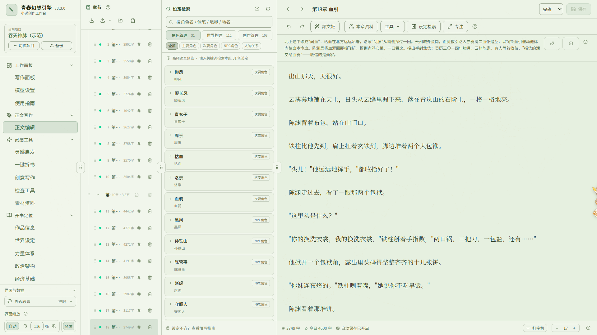
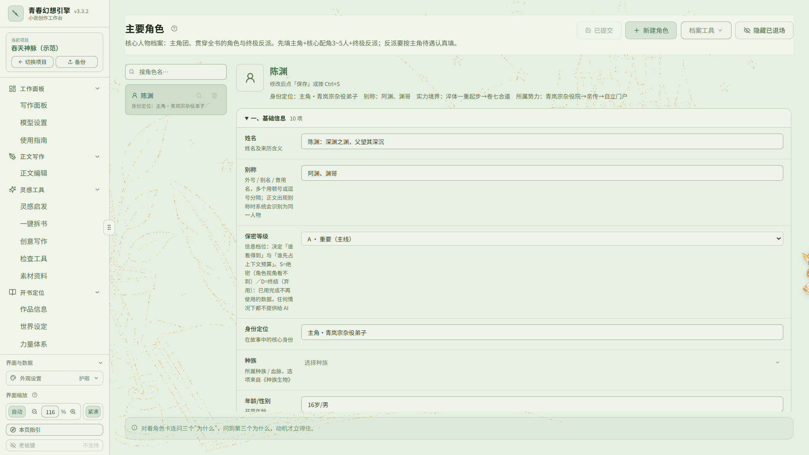
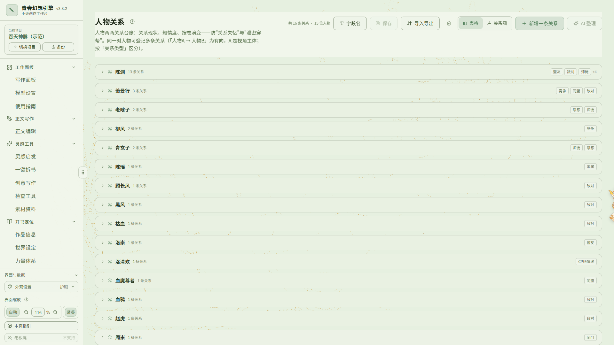
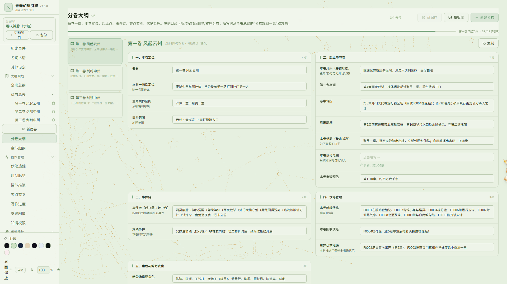
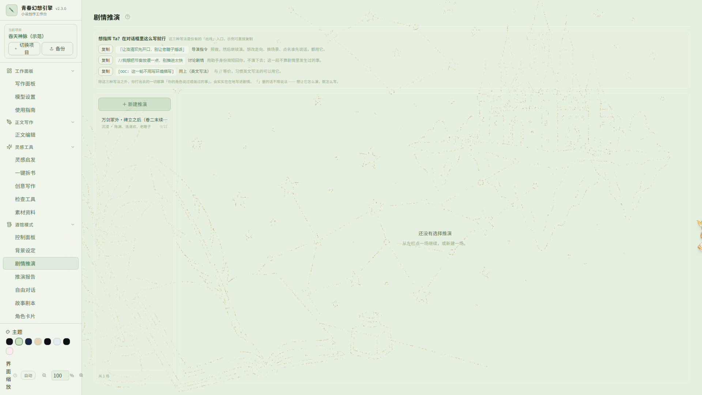
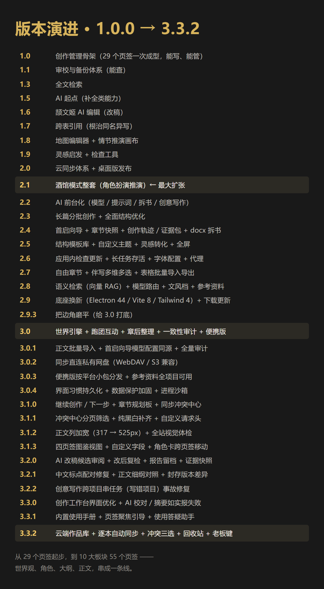

<div align="center">


# 青春幻想引擎 · novel-studio

**把世界观、角色、大纲、正文串成一条线的长篇创作工作台**

Windows 桌面应用 ｜ 项目数据存本机 ｜ 可接入本地或云端大模型 ｜ `v2.5.0`

📦 仓库：[gitee.com/tgxy2026/youth-fantasy-engine](https://gitee.com/tgxy2026/youth-fantasy-engine)　｜　⬇️ 下载：[Releases](https://gitee.com/tgxy2026/youth-fantasy-engine/releases)

</div>

---

## 写在前面（请先读这段）

**1. 这是一款使用 AI 辅助开发的项目。**

从第一行代码到现在，开发过程大量借助了 AI 编程工具。这点我先摊开讲，不藏着。

**2. 它没有任何后门、病毒或违规代码。**

- **不联网也能完整使用**，不依赖任何在线服务；
- **不会偷偷上传你的稿件、设定或任何数据**；
- 唯一的对外网络请求，是你**自己主动配置**的大模型 API —— 用本地模型时，一个字节都不出你的机器。

**3. 关于内置的 AI 功能，我的立场是「辅助，不是代笔」。**

软件内置了一整套 AI 能力：一键续写、整章改写、一键拆书、创意写作、角色扮演推演……但设计这些功能的**本意是辅助创作** —— 帮你把设定理顺、把大纲排好、在卡壳的地方推一把，让你写得更顺，而不是替你写。

**我不建议使用 AI 大规模生成小说正文。**

如果你只是想玩玩、图个新鲜，那无所谓，功能就在那儿。但如果你真心想成为一名网络小说作者 —— **不建议**。作品得是你自己的，这条路没有捷径可走。

---

## 它解决什么问题

写长篇，真正的敌人往往不是"没有灵感"，而是**失控**。你有没有遇到过这些事：

- 世界观写了一箩筐，写到第 80 章想查「主角师父的师门叫什么」，翻了半小时没找着；
- 人物越写越多，谁跟谁什么关系全靠脑子记，写着写着就串了；
- 埋了个伏笔，二十万字以后你自己全忘了，读者倒是记得清清楚楚；
- 大纲在 A 文档、正文在 B 文档、设定在 C 文档，改一处要同步三处；
- 写到一半卡住，想推演「主角这时如果选 X 会怎样」，只能在脑子里空转。

novel-studio 就是为这些事做的。

它**不是「AI 帮你写小说」**，而是 —— **把你散落在各个文档里的创作资产，收进一个有结构、能互相关联、能按需喂给 AI 的工作台。**

---

## 功能总览

**10 个板块，49 个页签。**

| 板块 | 包含页签 |
|---|---|
| **工作面板** | 写作面板 · 模型设置 · 使用指南 |
| **开书定位** | 作品定位 · 世界设定 · 力量体系 |
| **角色管理** | 主要角色 · 次要角色 · NPC · 人物关系 |
| **世界构建** | 国家势力 · 势力关系 · 地理风物 · 地图编辑 · 地图 · 种族生物 · 物品资源 · 历史事件 · 名词术语 · 其他设定 |
| **大纲规划** | 全书总纲 · 分卷大纲 · 章节细纲 · 章节总表 |
| **创作管理** | 伏笔追踪 · 时间脉络 · 情节推演 · 爽点节奏 · 写作进度 · 支线剧情 · 知情权限 |
| **灵感工具** | 灵感启发 · 一键拆书 · 创意写作 · 检查工具 · 素材资料 |
| **酒馆模式** | 控制面板 · 背景设定 · 剧情推演 · 推演报告 · 自由对话 · 故事剧本 · 角色卡片 |
| **正文写作** | 正文编辑 |
| **运营维护** | 写作规范 · 设定变更 · 灵感素材 · 读者反馈 · 关于打赏 |

### 几个值得一提的设计

- **角色与关系双轨** —— 角色卡管「这个人是谁」，人物关系表管「谁跟谁什么关系」，可图谱可视化。
- **从总纲到细纲再到正文的完整链路** —— 分卷大纲 → 章节细纲（带事件链）→ 正文，每一层都能喂给 AI。
- **伏笔追踪** —— 埋了什么、在哪一章回收，一张表管到底，埋了不回收会被揪出来。
- **时间脉络** —— 故事内时间线，支持自定义历法，避免"人物年龄对不上"。
- **情节推演** —— 推演分歧点的不同走向，产出推演报告。
- **防剧透机制** —— 可标记「某角色在某章之前不知道某件事」，AI 推演时不会漏嘴。
- **保密等级** —— 设定可按等级划分，**最高保密等级的设定任何情况下都不会进入 AI 上下文**。
- **一键拆书** —— 丢一本参考书进去，自动抽取人物、关系、设定，做成你自己的素材库。
- **酒馆模式** —— 让 AI 扮演你书里的角色跟你对话、推演剧情，用来找感觉、验人设。
- **伴写建议** —— 正文编辑时给出「下一句可以怎么写」的建议，你采纳或忽略，它不会替你写。
- **提示词全开放** —— 所有 AI 提示词都可在设置页里查看和修改。

---

## 快速开始

### 方式一：下载安装包（推荐）

到本仓库的 **Releases** 页面，下载最新的 `青春幻想引擎-Setup-x.x.x.exe`，双击安装即可。

> ⚠️ Windows 首次运行可能弹 SmartScreen 提示 —— 点「更多信息」→「仍要运行」。这是所有未购买代码签名证书的软件的常规待遇，不等于病毒警告。

### 方式二：从源码运行

```bash
git clone https://gitee.com/tgxy2026/youth-fantasy-engine.git
cd youth-fantasy-engine
npm install
npm run dev            # 浏览器调试：http://localhost:5199
```

打包桌面版：

```bash
npm run build:desktop  # 产物输出到 release/ 目录
```

> 需要 **Node.js 20 或更高版本**。

### 系统要求

| 项 | 要求 |
|---|---|
| 操作系统 | Windows 10 / 11（64 位） |
| 内存 | 建议 8GB 以上 |
| 磁盘 | 约 500MB |
| Node.js | 仅源码方式需要，20+ |

---

## 界面截图


<table>
<tr>
<td width="50%"><br/><sub>写作面板：进度、模型、上手引导</sub></td>
<td width="50%"><br/><sub>正文编辑与伴写建议</sub></td>
</tr>
<tr>
<td><br/><sub>角色卡</sub></td>
<td><br/><sub>人物关系</sub></td>
</tr>
<tr>
<td><br/><sub>章节细纲</sub></td>
<td><br/><sub>酒馆模式：剧情推演</sub></td>
</tr>
</table>

> 截图取自软件内置的示范项目《吞天神脉》。

---

## 数据与隐私

- **数据完全存在本地。** 桌面版把整个库存成一个 JSON 文件，放在你自己的机器上；浏览器调试模式走 IndexedDB。
- **本软件不搭服务器、不经手你的数据。**
- **想跨设备同步？** 把数据文件放进任意云盘同步文件夹（OneDrive / 坚果云 / 百度网盘等）即可 —— 不需要注册、不需要登录、不需要联网到任何第三方服务。
- 图片入库前会先压缩，避免库文件无限膨胀。
- ⚠️ 换设备前请先**关闭软件**并等待云盘同步完成，避免半同步状态造成数据冲突。

---

## AI 功能说明

### 支持的模型来源

**本地模型（数据不出本机）**

| 类型 | 说明 |
|---|---|
| Ollama | 填本地地址即可，推荐 |
| 本地 OpenAI 兼容服务 | LM Studio / vLLM 等任意兼容实现 |

**云端模型（会把选定上下文上传给该服务商）**

硅基流动 · DeepSeek · 通义千问 · 智谱 GLM · 豆包 · Kimi · MiniMax · 腾讯混元 · 百川智能 · 零一万物 · Groq · OpenRouter · OpenAI · 自定义接口

### 数据会发给谁

**只发给你当前选定的那个模型。**

用本地模型 → 完全不出本机；用云端模型 → 当前会话所需的上下文会上传给该服务商。软件内置上下文预算控制，让你能看清"这次要发多少、发了哪些"。

### 上下文是怎么控制的

- **预算上限**：本地模型默认 32K 上下文预算，超出的内容按优先级裁剪；
- **保密等级**：设定可分级，最高等级**任何情况下都不进 AI**，作者侧的推演也同样排除；
- **防剧透**：角色视角推演时，只看该角色在当时的章节节点应该知道的信息。

---

## 技术栈

| 层 | 选型 |
|---|---|
| 框架 | React 18.3 + TypeScript 5.5 |
| 构建 | Vite 5.3 |
| 桌面端 | Electron 31 + electron-builder |
| 样式 | Tailwind CSS 3.4 |
| 存储 | IndexedDB（浏览器）/ JSON 文件（桌面） |
| 图标 | lucide-react |
| 模型调用 | OpenAI 兼容协议 + Ollama 原生协议，支持 SSE 流式输出 |

---

## 项目结构

```
youth-fantasy-engine/
├── src/
│   ├── components/          React 组件（按功能域分子目录）
│   ├── lib/                 核心逻辑
│   │   ├── aiTasks/         AI 任务实现（按域拆分）
│   │   ├── db/              存储层（门面 + 分域实现）
│   │   ├── flow/            通用创作链路件
│   │   └── schema.ts        页签与字段定义（单一数据源）
│   ├── data/                内置数据：示范项目、素材库
│   └── assets/              资源文件
├── electron/                Electron 主进程与 preload
├── tests/                   基线测试与结构闸（npm test）
├── scripts/                 构建与清理脚本
├── dev-seed/                开发用种子数据
└── docs/screenshots/        文档截图
```

---

## 开发命令

| 命令 | 作用 |
|---|---|
| `npm run dev` | 启动开发服务器（:5199） |
| `npm run build` | 类型检查 + 构建前端 |
| `npm run build:desktop` | 打包 Windows 桌面版 |
| `npm test` | 跑基线测试与结构闸 |
| `npm run typecheck` | 仅类型检查 |
| `npm run lint` | ESLint 静态检查 |
| `npm run verify` | 类型检查 + lint + 测试 |

---

## 版本演进



| 版本 | 主题 |
|---|---|
| 1.0 | 创作管理骨架（29 个页签一次成型，能写、能管） |
| 1.1 | 审校与备份体系（能查） |
| 1.2 | 输入体验件（长文本、日期、人物选择器、可拖拽面板） |
| 1.3 | 全文检索 |
| 1.5 | AI 起点（补全类能力） |
| 1.6 | 改稿助手 + 交互基建 |
| 1.7 | 跨表引用（根治同名异写） |
| 1.8 | 地图编辑器 + 情节推演画布 |
| 1.9 | 灵感启发 + 检查工具（数据体检） |
| 2.0 | 云同步体系 + 桌面版发布 |
| 2.1 | **酒馆模式整套**（角色扮演推演，最大一次扩张） |
| 2.2 | AI 前台化（模型设置 / 提示词可编辑 / 拆书 / 创意写作） |
| **2.3** | **长篇分批创作 + 全面结构优化** |
| 2.4 | 首启向导 + 长篇性能基线 + 章节快照升级 + 创作轨迹/证据包 + **世界观多套结构 / docx 拆书** |
| **2.5** | **结构模板库 + 配比对照 + 自定义主题**（**当前版本 2.5.0**） |

**2.5.0 本轮重点**（结构方法论 + 主题自由度 + 安装体验）：

- ⭐ **结构模板库**：内置四套全书结构 —— 三幕式 / 十五拍结构 / 起承转合 / 网文三卷式，每套带各节拍的**定义与自问引导**（文案全部自撰，不搬运任何书籍原文）。创意写作做大纲规划时可选用一套作为**全书结构参考**，AI 会贴合节拍占比但不会机械对齐；情节推演画布可**按模板一键铺出节拍节点**（纯本地，不调 AI）。
- ⭐ **全书结构配比对照**：在检查工具页新增一栏，把你的**实际章节 / 字数分布**与所选模板的理想占比并排画成双条带，逐拍给出偏差（贴得稳就不打扰，偏了才说）。全部本地计算、不发 AI 请求、**只描述不评判** —— 十章以下只给理想预览，不硬算。
- ⭐ **自定义主题**：侧栏主题选择器新增「自定义」—— 选一个**母版**打底，再调**强调色**与**全书色相偏移**两个参数，其余颜色由算法派生。派生过程内置 **WCAG 对比度守卫**（正文可读性不因换色而下降），切换主题不留残色。不想调就什么都不动：母版原样、强调色跟随母版。
- **安装目录可选**（社区反馈）：安装时可以**自定义安装目录**了；默认路径不变（仍是当前用户目录，无需管理员）。请选择当前用户**有写权限**的目录 —— 装到 Program Files 等系统目录会因权限不足安装失败。
- 本版同时完成一轮**六维全量审计**（实机 44 断言 + 八支扫描器 + 双闸）与 **110 项入口测试**全绿。
**2.4.4 社区反馈版**（设定草稿箱 + 时间自由化 + 时间轴可视化 + 六维审计）：

- ⭐ **「设定草稿箱」**：世界设定 / 力量体系表单下方多了一块不限长度、跟着字数长高的自由文本区 —— 没想好表格怎么填时先把想法堆在这儿落档。它**不发给 AI**（界面上有标注），想让它变成正式设定时点「AI 整理到上方字段」即可。母级与每个子世界**各有一份**。
- ⭐ **AI 补全弹窗内置「草稿本」**：全项目所有「AI 补全」弹窗（表单 / 角色卡 / 表格整行单行）都能带一段自己的草稿进来，按位置各自保存、自动存盘，点「带入」才随本次请求发给模型。
- ⭐ **时间字段自由化**：历史事件 / 时间脉络的「故事内时间」拆成「**发生时间 / 结束时间**」（时间点事件两端填同一天即可）；年份**允许负数与 0**；新增**项目级历法规则**（一年几个月 / 每月几天，默认 12 月 × 30 天），月 / 日的候选范围跟着你的设定走；老数据自动迁移。
- ⭐ **时间轴可视化**：历史事件时间轴改为单行水平轴；持续事件在轴上方用**彩色线条**标出时段（同一时间点的卡片竖向排列，相互重叠的线条自动异色区分，颜色与卡片左缘色条一一对应）。
- **八套主题对比度按 WCAG 治理**：正文 / 次级文字 / 强调色全部达标，并新增自动闸防止以后退回。
- **角色卡「所属势力」支持多选**（主要 / 次要 / NPC 三张卡同步），并提示「多个势力时 AI 可能对从属关系判断不清」；正文右侧看板娘的触发热区收窄到可见部分，不再「稍微靠近就弹出」。
- 本版同时完成一轮**六维全量审计**（代码 / 结构 / 内容 / 提示词 / UI / 功能），修复 18 项 —— 含两处同步层的静默数据风险与酒馆记忆的一处不可逆隐患。

**2.4.3 修复版**（修掉 2.4.1 / 2.4.2 的一个界面布局缺陷）：

- 🔴 **酒馆「剧情推演」「自由对话」的对话窗口只占约一半高度，下方留一大片空白**（实测约 490px / 487px）。同一个原因还让**编辑器**的内容顶出窗口 —— 多出来的部分既看不见、也滚不到。根因是上一个版本为修「表格/卡片表头滚动时从页头穿过去」，在页面内容外面**多包了一层容器却没给它高度**，于是页面里那些「撑满窗口」的写法（高度＝父层 100%）失去参照、退化成按内容高度。本版把高度补回。
- 实测三处空白**归零**；并复验：表格/卡片的**表头仍正常贴住顶部**（当初挪那层 padding 的初衷没被破坏）、**长表单页仍可滚到底**、编辑器正文/缩进/高亮**逐项不变**。
- 本版**同样包含 2.4.2 的全部内容**（世界观多套结构 / docx 拆书 / 分平台预检 / 本章体检 / 导出增强 / 备份二期 / 三处静默隐患修复）。
- ⚠️ 该缺陷**同时影响 2.4.1 与 2.4.2**，这两个版本的用户建议升级。

**2.4.2 本轮重点**（无限流结构补齐 + 三处静默隐患修复）：

- ⭐ **世界观 / 力量体系改为「母级 + 子级」结构**：顶层一个全书统一的设定（**永远发给 AI**），下面可建任意多个**子世界 / 子体系**（副本、世界线、剧本各一套），每个带一个「活跃 / 已完结」开关 —— **只有标为「活跃」的才发给 AI**，且界面上会写明「另有 N 个已完结，未发送」，不会让你误以为 AI 读过全部。只建一套设定的用户**感觉不到任何变化**。
- **一键拆书支持 .docx**：Word 稿子不用再另存为 txt（另存会丢缩进）。**零新增依赖** —— 走软件自己的解析实现，安装包体积没有变化；首行缩进按 Word 的段落属性还原成中文全角缩进；**读不到的内容会如实列出**（批注 / 脚注尾注 / 页眉页脚 / 图片 / 公式 / 修订删除的文字）。
- **分平台投稿预检**：挑「晋江 / 起点 / 通用」档位，看敏感词命中里**哪些类别属于该平台通常更关注的**，以及分章字数事实。**只摆事实、不判合格与否**，并注明规则以平台后台为准。
- **本章体检**：选一章，把已有的五个确定性引擎（连续性 / 伏笔 / 敏感词 / 错别字 / 文风）**一次跑完并分组呈现**，全部本地计算、不发 AI 请求。此前这五件事分散在四个入口。
- **导出增强**：导出时多了个**格式弹窗**（带实时预览）—— 章节标题（原样 / 补「第N章」/ 不带）、段落间距、卷标题开关、**设定附录**、Markdown 标题层级（并稿时避免标题层级打架）。选项跨项目记忆；**不调任何选项时导出结果与旧版逐字节一致**。
- **备份体系第二期**：备份列表不再需要把每份备份整包读出来算体积（**秒开**）；任意一份可**导出成独立文件**，也能**从该文件恢复**。
- 🔴 **三处静默隐患（这版最该升级的理由）**：① 酒馆角色记忆整理被判定为「整份退化」时内容不被覆盖（对），但**记录位置照常前移** —— 那段对话被永久越过、以后再也总结不到，而界面还提示「本次未覆盖」暗示可以重试 → 现在退化时**不推进位置**；② 早期版本把搜索密钥存在**另一处容器**里，它会整条随加密同步文件走，而界面承诺密钥不上传 → 新增一次性迁移顺手清理；③ 同步合并还有**第三条「删了会复活」路径**（本地已删的记录会被云端旧值补回）→ 按墓碑判据补齐并加防回退测试。另外：关窗前的最后一次写盘此前把「没返回值」当成功；酒馆两处中止信号被吞掉。
- **内部加固**：三个巨型组件完成收尾拆分（颉文姬 1033→91 行 / 创意写作 982→73 / 酒馆控制面板 913→114 —— 机械搬迁 + 实机指纹比对 + 负面对照，界面表现逐项全等）；**层级号收敛到统一真源**（16 处；编辑器双图层这类有特殊语义的明确不收敛，判定写进了代码注释）；界面文案里残留的 markdown 星号清干净（13 处 / 9 文件）；清理死代码 3 处、合并两处重复判断；**补上 4 项此前无测试覆盖的修复的回归断言**。

**2.4.1 本轮重点**（打磨与加固 —— 一处数据安全修复 + 一批手感修正）：

- 🔴 **重要修复：多角色收尾不再"张冠李戴"**。酒馆自由对话里一场有多个角色的对话点「结束本轮对话」时，若**某一位角色的记忆读取失败**（比如存档被云盘瞬时占用），程序会跳过这位继续处理下一位 —— 但写回用的**编号已与角色错位**，于是后面的记忆统统往前串一位，**AI 给 A 整理出的记忆被写进 B 的档案**；串到最后一位还会越界、整场收尾中断。现在编号与角色严格对齐，读失败的那位**本轮跳过不写**并如实提示。⚠️ 这个 bug 是**静默**的（界面照样显示「本轮已结束」），所以这是本次升级的首要理由。
- 🔴 **你刻意隐藏的消息不再进 AI 材料**：推演报告与记忆整理在统计时漏过滤了隐藏消息，你"藏起来"的内容反而成了判定依据。
- **酒馆未配模型时发送键直接变灰并说明原因**：此前链路里没有"就绪守卫"，未配模型点发送会一路走到模型层才失败（甚至被流式状态吞掉），你会以为"这功能坏了"。
- 🔴 **就绪判据严格同源**：酒馆的模型来源是「会话 → 控制面板默认 → 全局活动模型」三层兜底链，**不是**只看全局活动模型 —— 所以"未就绪"的判定也走同一条链，**你在控制面板指定的模型只要能用，就绝不会被误判成"没配"**。
- **同步与存储**：启动时自动恢复云盘同步不再与"存储不可写"状态打架（该路径此前漏了检查，与手动路径不对称）；生成同步对比快照时补上本地专属配置的排除。
- **界面手感**：卡片页头不再"从表头上面穿过去"（此前靠内边距 24px 与负外边距 12px **恰好抵消**来定位，任一改动就穿帮）；编辑器正文与高亮叠层不再差一个**滚动条宽度**；叠层补无障碍标记；复制申报说明走统一入口（此前绕过封装、部分环境静默失败）；术语统一为「有未保存的改动」；页面说明里残留的 markdown 星号已清；首启向导的「跳过」键改为与同排一致的样式。
- **内部加固**：新增两道防回退测试（酒馆就绪判定含负面对照、AI 数据来源清单与真实页签名对账）；修掉一个扫描工具自身缺陷（会把文件中第一处相同代码当成目标而误报）；一批"魔法数字"收敛到统一常量。

**2.4.0 本轮重点**（三件事：上手更快、扛得住长篇、过程可自证）：

- **首启向导**：第一次打开先问一句「你想怎么开始」—— 建新书 / 看示例 / 跳过，三选一，不再面对空界面。另加「新手引导」入口讲清每个页签干什么。
- **长篇性能基线**：新增常驻性能压测（321 章 / 101 万字库：冷启动约 1.5 秒、切章约 146 毫秒）。以前"写到几十万字会不会卡"只能靠感觉，现在**每次改代码都会自动比对，退步会被拦下**。
- **章节快照升级**：优先淘汰最旧的自动快照（手动存的不会被挤掉）；时光机显示每版**从哪来**（自动 / 手动 / AI）；**任意两版可直接对比**。
- **创作轨迹 + 证据包**：新增「创作轨迹」页签，记录每次改动与 AI 辅助占比；证据包可按「本章 / 整书」导出，保留原始缩进，桌面版可直接出 **PDF**。定位是**创作主权存证 + 质量自检 + 如实申报** —— 本软件**不做也不参与**任何"反检测 / 洗 AI 痕迹"的事。
- **打字手感**：**Tab / Shift+Tab 永远是缩进**（不会再被当跳转用）；一键排版默认**保留你已有的缩进**；导出不再吃掉行首缩进。
- **采样参数按模型记忆**：换个模型写作，温度等参数跟着模型走，不用每次重设。
- 🔴 **数据安全（两处真修复）**：① 又挖出一条"删了会复活"的隐藏路径（兜底镜像会把本机删掉的记录补回、还清掉墓碑）→ 已堵；② 「从备份恢复」此前会把这个项目的**章节快照全部清空且不补回** → 现在不动你的时光机。
- 🔴 **密钥不再外流**：搜索服务的密钥此前会随云盘同步文件写出（界面却承诺"不上传"）→ 已改为整条本地专属。
- **其他修正**：「近 7 日日均」改为真·近 7 个自然日（此前取"最近 7 条有记录的天"，断更时会被高估）；创意写作的功能说明改为如实（默认只新增设定、不改已登记条目）；按钮同排尺寸统一（2 处）；若干静默失败改为可见提示。

**2.3.1 修复版**（不加新功能，只修问题）：

- **日期输入修好了**：表格里的「某年某月某日」三段式输入，此前**年份填不进去、月份选了不显示、日子点不动**（三个框互相锁死）—— 现已改为逐级写回，年 → 月 → 日 都能正常输入并联动（含闰年天数）。
- **字数口径可切换**：看板与写作面板支持「只算汉字 / 汉字＋标点」切换；后者与网文平台的计费口径一致（实测标点约占正文 18%）。**只影响显示，不改动已存数据**。
- **看板娘可开关**：项目管理首页加了显示开关，不喜欢右下角立绘的可以关掉。
- **高分屏适配**：看板娘与左下角同步面板改为按视口比例缩放，十几寸 2K 屏下不再遮挡按钮。
- **数据安全（两个真 bug）**：① 关闭同步时，云端已被清空的表会被整片跳过，导致本地旧记录"复活"；② 云模式下「已删除的记录」在特定时序会被陈旧快照回灌。两处均已修复。

**2.3.0 本轮重点**（这是一个"不加功能、只改结构"的版本）：

- **长篇创作**：创意写作改为两阶段分批 —— 先分批排大纲，再分批写正文；起点自动判定；正文按大纲切卷。
- **缺口补齐**：卷没排满先补满该卷，章没写完先补完该章，而不是急着开新卷。
- **字数硬校准**：目标字数按汉字口径硬卡（±300 字），改写 / 扩写 / 续写结果一律过闸。
- **架构**：任务层与存储层拆分为「门面 + 域模块」；五个巨型组件拆分；全项目 `any` 归零。
- **数据安全**：云盘同步墓碑机制（删掉的记录不再"复活"）、数据文件身份校验、读取失败时中止写入而非猜成空库。
- **新增页签**：「其他设定」—— 世界构建的兜底页，前面几张专表放不下的零散设定都有地方放，**而且照样进 AI 的设定资料**。

---

## 已知限制

- **仅 Windows 桌面版**，无 Mac / Linux 版本。
- **仅简体中文**，暂无多语言支持。
- 跨设备同步依赖云盘文件夹，**不是实时同步**，换设备前需手动等同步完成。
- 超长篇（百万字级）的性能优化仍在进行中。
- 内置 AI 功能需要你自己准备模型（本地或云端），软件本身不附带任何模型。

---

## 反馈与交流

- 发现 bug 或有功能建议 → 欢迎开 **Issue**；
- 想直接改代码 → 欢迎提 **Pull Request**；
- 用这个工具写出了作品，也欢迎回来告诉我一声。

## 支持作者

如果这个工具帮到了你，软件内置了「关于打赏」入口。

不打赏完全不影响任何功能 —— 用它写出好作品，就是最好的回报。

## 许可证

[MIT](LICENSE) —— 可自由使用、修改、分发，保留版权声明即可。
